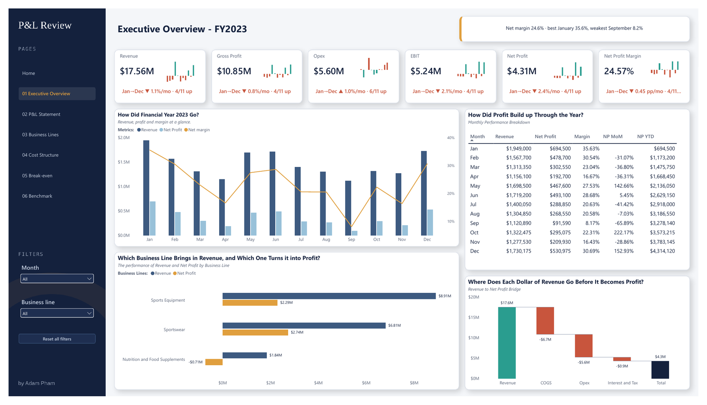
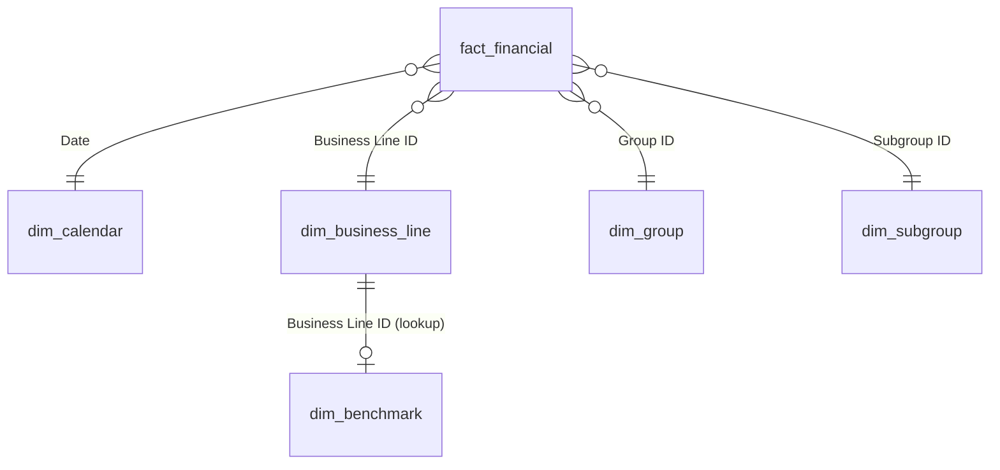
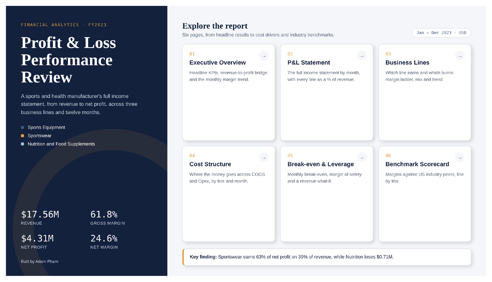
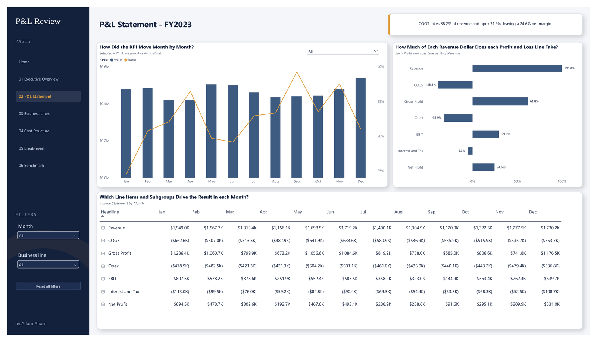
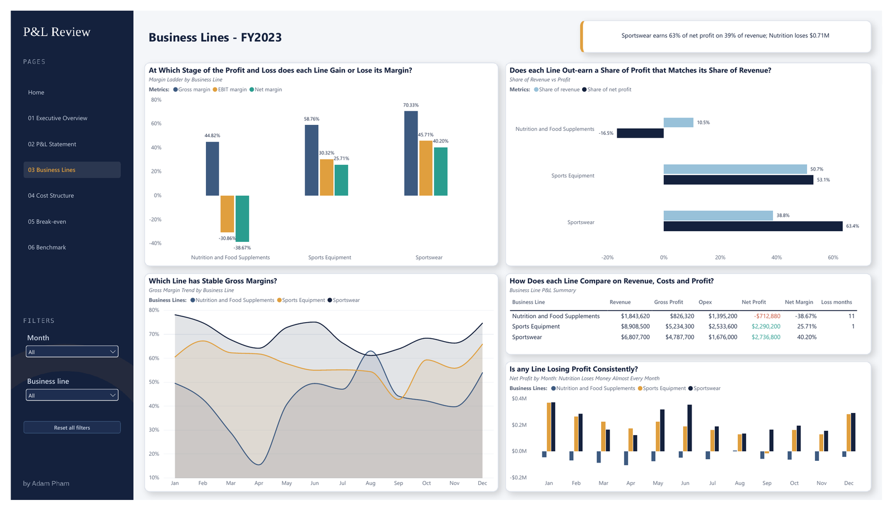
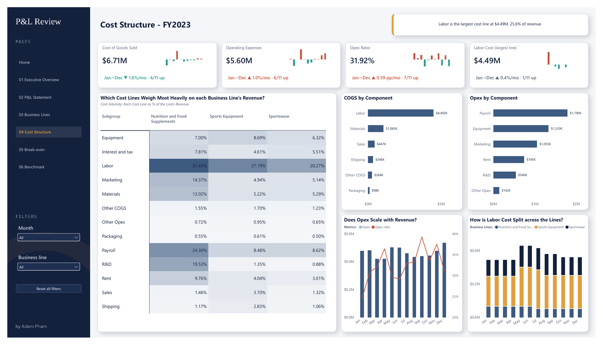
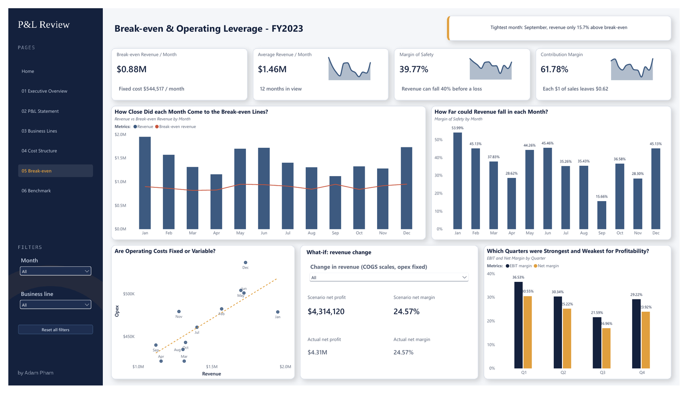
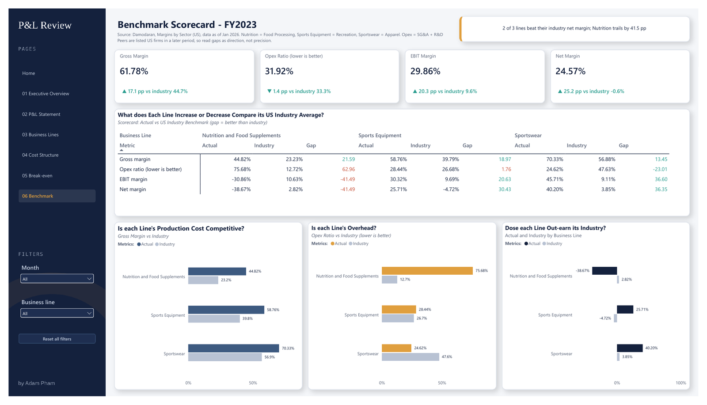

# FY2023 P&L Performance Dashboard (Power BI)

An end-to-end Power BI report on a sports and health company's FY2023 profit and loss. It answers one question for management: **where does the company make money, where does it lose it, and how much room is there before profit turns into a loss?**



**Tools:** Power BI Desktop (PBIP format), Power Query (M), DAX, HTML/CSS for the landing page.

**Headline results:**

| | FY2023 |
|---|---|
| Revenue | $17.56M |
| Net profit | $4.31M (24.6% margin) |
| Most profitable line | Sportswear: 63% of net profit from 39% of revenue |
| Loss-making line | Nutrition and Food Supplements: −$0.71M, a loss in 11 of 12 months, driven by operating costs rather than product margin |
| Margin of safety | Revenue could fall roughly 40–48% before the business breaks even |

---

## 1. Problem

The company sells through three business lines: Sportswear, Sports Equipment, and Nutrition and Food Supplements. The raw data is a monthly general ledger extract. It shows totals, but it does not answer the questions a finance manager actually asks:

1. How did the business perform over the year, and is performance improving or slowing down?
2. How does each revenue dollar flow down to net profit?
3. Which business lines create value, and which destroy it?
4. Where is the cost base concentrated?
5. How far can revenue fall before the company makes a loss?
6. How do our margins compare with the industry?

Each question maps to one report page.

## 2. Data

The source is a monthly P&L dataset for FY2023 (Jan–Dec 2023). It contains a fact table of 580 ledger rows and seven small lookup tables, delivered as CSV files.

**Source:** the dataset was provided by The Future Analytics as the capstone project for the course *Master Analytical Thinking & Data Analysis With Power BI*. **It is not redistributed in this repository.** See [data/README.md](data/README.md) for the expected files and schema, so the report can be reconnected to the same or similar data.

The model is a star schema. `fact_financial` sits in the centre, with dimensions for calendar, business line, P&L group and subgroup. Full details are in [docs/data_model.md](docs/data_model.md).



The industry benchmarks come from Aswath Damodaran's *Margins by Sector (US)* dataset (January 2026, NYU Stern). Each business line is mapped to its closest industry: Apparel, Recreation, and Food Processing.

## 3. Method

**Data cleaning (Power Query).** All fixes reconcile back to the source: 580 rows and $4,314,120 net profit before and after. Full log: [docs/data_cleaning.md](docs/data_cleaning.md).

- Removed non-breaking spaces from business line names, trimmed them, and converted them to title case.
- Renamed `Amount, $` to `Amount` and fixed a misspelled column (`Leyend` → `Legend`).
- Split the "Other" subgroup. It was posted under both Opex and COGS with the same ID, so the COGS rows ($263,700) now have their own subgroup.
- Set sort orders, hid helper columns, and marked `dim_calendar` as the date table.

**Modelling (DAX).** There are 159 measures in a dedicated `*Measures` table, organised into 10 display folders (Base → P&L → Ratios → Time → Break-even → Benchmark → Display). The full catalogue with every formula is in [docs/dax_measures.md](docs/dax_measures.md). A few design choices are worth calling out:

- **Signed ledger handled once.** Expenses are stored as negative numbers. The sign is flipped in the four base measures only, so every downstream measure reads naturally.
- **One measure drives the P&L statement.** `P&L Value` uses `SWITCH` on the P&L line order, so a single matrix renders Revenue → COGS → Gross Profit → Opex → EBIT → Interest & Tax → Net Profit, and subtotals blank out when the matrix is expanded to subgroup level.
- **Break-even analysis.** COGS is treated as variable and everything below gross profit as fixed: `Break-even Revenue = Fixed Cost ÷ Contribution Margin %`. The assumption is stated on the page, and its effect is quantified under [Limitations](#limitations-and-assumptions).
- **Revenue-weighted benchmark.** Each business line's industry margin is weighted by that line's revenue, so the company-level benchmark changes correctly when a slicer filters the lines.
- **Trend labels that cannot be misread.** The KPI cards show the compound monthly change from January to December, plus how many months rose. A simple average of month-on-month % was rejected because it points the wrong way on this data: revenue averages +1.0% a month, yet December revenue is 11% below January. Moves under 0.5% a month (or 0.25 pp for ratios) are shown in grey rather than red or green.

**Design.** The report has a landing page built in HTML/CSS and rendered as the page background, with transparent buttons for navigation. There are six analysis pages with a shared navigation rail, synced Month and Business line slicers, and a "Reset all filters" button. A custom theme ("Midnight Ledger": navy, steel, amber) uses green and red only for good and bad movements.

## 4. Results

| Page | Question it answers | Key finding |
|---|---|---|
| 01 Executive Overview | How did FY2023 go? | Profitable all year: $4.31M net profit at a 24.6% margin. Margin slid from 35.6% in January to 30.7% in December, and September was the weakest month (8.2%). |
| 02 P&L Statement | Where does each revenue dollar go? | Of every $1 of revenue, 38¢ goes to COGS and 32¢ to operating costs, leaving a 29.9% EBIT margin. |
| 03 Business Lines | Who makes the money? | Sportswear earns a 40.2% net margin and Sports Equipment 25.7%. Nutrition loses money (−38.7% net margin, −$0.71M) even though its gross margin is positive (44.8%): operating costs absorb 75.7% of its revenue, against 28.4% and 24.6% in the other two lines. |
| 04 Cost Structure | Where is the cost base? | Gross margin is 61.8% and the opex ratio is 31.9%. Opex stayed flat while H2 revenue softened, so net margin fell from 28.0% in H1 to 20.7% in H2. |
| 05 Break-even & Leverage | How much buffer is there? | Break-even is about $0.88M of revenue a month against a $1.46M average, a margin of safety of about 40%. This is a conservative floor; see Limitations. |
| 06 Benchmark Scorecard | How do we compare with the industry? | Sportswear and Sports Equipment sit well above the US industry averages for their sectors. Nutrition sits far below Food Processing (2.8%). The comparison is directional, not a like-for-like peer group. |

**What the report suggests:** the profit problem is concentrated in one business line, and it sits in operating costs, not in product margin. Nutrition still earns about $0.83M of gross profit, so closing it would only help if its operating costs disappeared with it. The next step is to split Nutrition's opex into costs it causes directly and overhead allocated to it. If most of it is allocated overhead, exiting would push that cost onto the other two lines and lower company profit. Reviewing that cost base matters more than broad cost cutting, because the other two lines are already profitable.

<details>
<summary><b>All report pages</b></summary>

| | |
|---|---|
|  |  |
|  |  |
|  |  |

</details>

## Limitations and assumptions

- **Break-even treats interest and tax as fixed.** Tax moves with profit, but the source combines it with interest, so the two cannot be separated. Treating only opex as fixed lowers break-even to about $9.07M a year and raises the margin of safety to about 48%. The true figure sits in the 40–48% range. Opex is also treated as fully fixed, which overstates the buffer if some of it (e.g. commissions, freight) is variable.
- **Business-line costs may include allocations.** The ledger assigns every cost to a line but does not say which costs are direct and which are allocated overhead, so line-level net profit is a reporting view, not proof of what each line would earn on its own.
- **Benchmarks are US listed-company averages** (Damodaran, January 2026). They are useful for direction, but these are larger firms in a different market, so gaps should not be read as precise.
- **One year of data at monthly grain** (12 data points). Trends are descriptive; there is no prior year to test seasonality.

## 5. How to run

**Requirements:** Windows with [Power BI Desktop](https://www.microsoft.com/power-platform/products/power-bi/desktop) (a recent version that can open PBIP projects in the enhanced PBIR report format). No other software is needed.

1. Clone the repository:
   ```bash
   git clone https://github.com/phamhoangquynh21-spec/financial_report_project.git
   ```
2. Put the eight source CSV files in a folder (see [data/README.md](data/README.md) for names and columns).
3. Open `report/Financial_Project_TFA.pbip` in Power BI Desktop.
4. Go to **Transform data → Data source settings → Change Source**, point each CSV to your folder, then select **Refresh**.

Without the data you can still open the project. You can browse the model, measures and page layouts, but visuals stay empty until a refresh succeeds.

**Repository layout**

```
financial_report_project/
├── report/                 Power BI project (PBIP): report + semantic model as text files
├── assets/
│   ├── screenshots/        Page images used in this README
│   ├── tfa_home.html       Source of the landing page design
│   └── tfa_midnight_ledger_theme.json
├── data/                   Expected data files (data not included)
├── docs/                   Data model, cleaning log, full DAX catalogue
└── LICENSE                 MIT (report and code only; data excluded)
```

The PBIP format stores the report and model as text (JSON and TMDL), so every visual and measure can be reviewed in a normal Git diff, unlike a binary `.pbix` file.

## 6. What I learned

- **A correct number can still mislead.** My first KPI trend labels were mathematically right but mostly red, and readers took that to mean the company was losing money. It was not. Labelling the period ("Jan→Dec") and greying out small moves fixed the misreading without changing the calculation.
- **Averages of percentages are dangerous.** The average month-on-month revenue change was positive while revenue actually fell across the year. I now check summary statistics against the endpoints before showing them.
- **Clean the data before modelling it.** A shared "Other" subgroup ID across Opex and COGS would have silently misclassified $263,700 of cost. Reconciling row counts and net profit after every cleaning step caught it.
- **Know the limits of the source.** Interest and tax are combined in the ledger, so the "EBIT cover" ratio is not a true interest coverage ratio. I labelled it that way rather than presenting it as something it is not.
- **What I would do next:** replace the hard-coded file paths with a Power Query parameter so the project runs from any folder, add a prior-year comparison once FY2022 data is available, and publish to the Power BI Service with scheduled refresh.

---

**License:** report files, DAX and documentation are released under the [MIT License](LICENSE). The source data is not included and is not covered by this license. Industry benchmarks are credited to Aswath Damodaran, NYU Stern.

**Author:** Adam Pham, Bachelor of IT (Data Science & AI) and Bachelor of Business (Finance), University of Southern Queensland.
[GitHub](https://github.com/phamhoangquynh21-spec)
