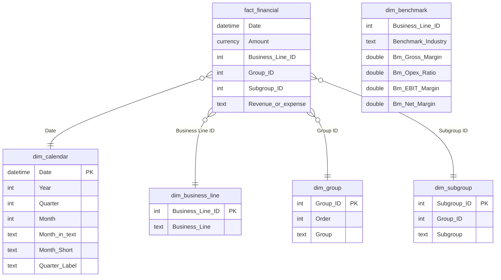

# Data model

The model is a star schema with one fact table at monthly grain. All relationships are many-to-one and filter in a single direction, from dimension to fact.

## Tables

| Table | Type | Source | Purpose |
|---|---|---|---|
| `fact_financial` | Fact | `Fact.csv` | 580 monthly ledger postings for FY2023. Revenue is positive, expenses negative. |
| `dim_calendar` | Dimension | `Calendar.csv` + 2 calculated columns | Marked as the date table. `Month Short` and `Quarter Label` are added for axis labels. |
| `dim_business_line` | Dimension | `Business Line.csv` | Three business lines |
| `dim_group` | Dimension | `Group.csv` | Revenue, Opex, COGS, Interest and tax |
| `dim_subgroup` | Dimension | `Subgroup.csv` + 1 added row | P&L line items. ID 16 "Other COGS" is added during cleaning. |
| `dim_headline` | Disconnected | `Headlines.csv` | Row layout of the P&L statement, used by `P&L Value` |
| `dim_kpi`, `dim_ratios`, `dim_metric` | Disconnected | CSV / DAX `DATATABLE` | Label tables for `SWITCH`-based metric selectors and the benchmark scorecard rows |
| `dim_benchmark` | Disconnected lookup | DAX `DATATABLE` | Industry margins per business line (Damodaran, January 2026), read with `LOOKUPVALUE` |
| `prm_revenue_change` | What-if parameter | DAX `GENERATESERIES` | Revenue shock slider for the break-even scenario |
| `*Measures` | Measure table | — | Home for all 159 measures, grouped into display folders |

`dim_benchmark` is deliberately **not** related to the fact table. Benchmarks are looked up inside measures and weighted by revenue, which keeps the filter flow of the star schema simple.

## Benchmark mapping

| Business line | Benchmark industry | Firms | Gross margin | Opex ratio | EBIT margin | Net margin |
|---|---|---|---|---|---|---|
| Nutrition and Food Supplements | Food Processing | 78 | 23.2% | 12.7% | 10.6% | 2.8% |
| Sports Equipment | Recreation | 49 | 39.8% | 26.7% | 9.7% | −4.7% |
| Sportswear | Apparel | 35 | 56.9% | 47.6% | 9.1% | 3.9% |
| Reference | Total Market (without financials) | 4,822 | 34.4% | 18.1% | 13.1% | 8.6% |

Source: Aswath Damodaran, *Margins by Sector (US)*, data as of January 2026. Opex ratio = SG&A/Sales + R&D/Sales; EBIT margin = pre-tax unadjusted operating margin. These are US-listed company averages, so they serve as a directional comparison, not a like-for-like peer group.
